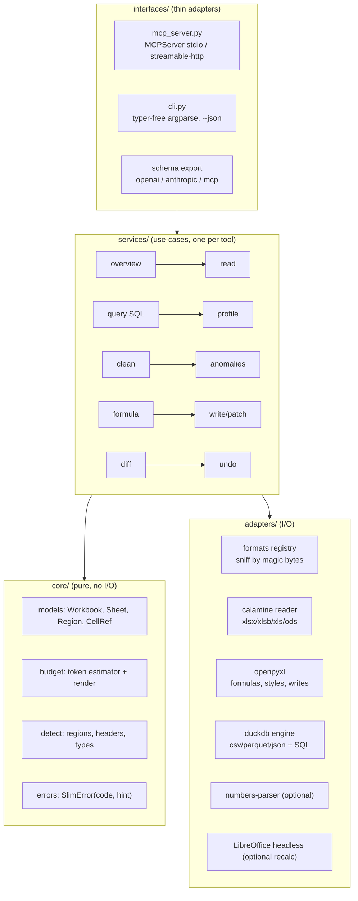

# slim-sheet — Master Plan

> A universal, token-frugal spreadsheet MCP server that **any** agent can drive —
> Claude (Pro or Free), OpenCode, Codex, Cursor, Ollama, LM Studio, Open WebUI,
> llama.cpp — from a 3B local model to a frontier model.

Status: **Phases 0–7 delivered (6 = design system, 7 = completeness, §17); Phase 8 (read-only macros + parity polish, §11.10) delivered; VBA writing awaits an owner decision — agent eval in progress** · Owner: j4flmao · Last revised: 2026-10-21

---

## 0. TL;DR

Most Excel MCP servers are either *thin openpyxl wrappers* (read cells / write cells),
*Windows-only COM bridges*, or *hosted SaaS*. All of them assume a frontier model
that can juggle 30–60 tools and read huge JSON blobs.

slim-sheet bets on three things the market does not do together:

1. **Read everything, locally.** One reader layer for `xlsx xlsm xltx xltm xlsb xls ods fods
   csv tsv txt parquet json/ndjson numbers` (+ Google Sheets via export URL later). No Office,
   no network, no Node — just `uvx slim-sheet`.
2. **Small-model first.** A *tiered tool surface* (`lite` = 8 tools, `standard` = 18, `full` = 30),
   flat primitive arguments, compact Markdown/TSV output under a hard token budget, and
   errors that tell the model exactly how to retry. A 7B model in LM Studio must be able to
   finish real tasks.
3. **Data-engine, not cell-poker.** DuckDB + Arrow underneath: SQL across sheets *and* files,
   out-of-core on 1M-row workbooks, plus profiling, cleaning, anomaly detection and a
   formula copilot (validate → explain → evaluate) — with **non-destructive writes by default**.

---

## 1. Competitive landscape (researched 2026-10)

| Project | Stack | Stars* | Strengths | Gaps we exploit |
|---|---|---|---|---|
| [haris-musa/excel-mcp-server](https://github.com/haris-musa/excel-mcp-server) | Python / openpyxl | ~4.2k | Huge write surface (~45 tools): charts, pivots, slicers, validation, CF, ~260-fn calculator, stdio + streamable HTTP | xlsx-family only (**no xls/xlsb/ods/csv read path beyond import**), tool count overwhelms small models, cell-oriented (no SQL), whole-workbook load in RAM |
| [negokaz/excel-mcp-server](https://github.com/negokaz/excel-mcp-server) | Go + Node wrapper | ~1.0k | Cell-budget paging (`PAGING_CELLS_LIMIT`), 7 tools only, screen capture (Win) | xlsx-family only, needs Node 20, no analysis/query, no formula intelligence |
| [sbroenne/mcp-server-excel](https://github.com/sbroenne/mcp-server-excel) | .NET / COM | ~830 | Real Excel: Power Query, DAX, Power Pivot, VBA, true recalculation, 63 tools / 400+ ops | **Windows + installed Excel only**, exclusive file lock, unusable on Linux/macOS/servers, very large surface |
| [PSU3D0/spreadsheet-mcp](https://github.com/PSU3D0/spreadsheet-mcp) (agent-spreadsheet) | Rust + WASM | ~60 | Best token design seen: compact shapes, continuation tokens, **region detection**, payload caps, native recalc engine | No Windows binaries, xls/xlsb read-only, no SQL, no cleaning/profiling |
| [marekrost/mcp-server-spreadsheet](https://pypi.org/project/mcp-server-spreadsheet/) | Python / DuckDB | small | SQL (incl. INSERT/UPDATE/DELETE) over sheets via DuckDB, xlsx/ods/csv, root sandbox env var | No xls/xlsb/parquet, values-only, no profiling, no formula help |
| [marlonluo2018/pandas-mcp-server](https://github.com/marlonluo2018/pandas-mcp-server) | Python / pandas | ~45 | Metadata + run arbitrary pandas code | "Sandbox" is a regex blacklist → unsafe; metadata from first 100 rows only |
| [theluckystrike/mcp-spreadsheet](https://github.com/theluckystrike/mcp-spreadsheet) | Node | ~0 | Reads xlsx/xlsm/xlsb/xls/ods/csv, atomic writes, header guess, no-eval expression language | Freemium caps (5k rows free), rewriting a sheet flattens formulas/formatting |
| [senoff/xlsx-for-ai](https://github.com/senoff/xlsx-for-ai) | Node client + **hosted** engine | small | Recalc (~350 fns), repair/healer, diff, audit, 52 tools | **Files leave the machine**, paid tier, no offline |
| [ZephyrDeng/spreadsheet-mcp](https://github.com/ZephyrDeng/spreadsheet-mcp) | TypeScript | small | View/filter/sort CSV+XLSX | Basic |
| [jonemo/openpyxl-mcp-server](https://mcpservers.org/servers/jonemo/openpyxl-mcp-server) | Python | small | Read-only, prebuilt binaries | Read-only, xlsx only |

\*Star counts as shown on GitHub/PyPI pages, Oct 2026.

### 1.1 What nobody does (our wedge)

| Capability | haris | negokaz | sbroenne | PSU3D0 | marekrost | **slim-sheet** |
|---|:-:|:-:|:-:|:-:|:-:|:-:|
| Read xls / xlsb / ods / numbers / parquet | ✗ | ✗ | via Excel | partial | ods | **✓ all** |
| Cross-platform, no Office, no Node | ✓ | ✗ | ✗ | partial | ✓ | **✓** |
| Tool tiers for small models | ✗ | n/a (7) | ✗ | ✗ | ✗ | **✓ lite/standard/full** |
| Hard token budget on every response | ✗ | cells | ✗ | ✓ | ✗ | **✓ tokens, not cells** |
| Table/region detection in messy sheets | ✗ | ✗ | ✗ | ✓ | ✗ | **✓ + multi-row headers** |
| SQL across sheets *and* files, out-of-core | ✗ | ✗ | DAX | ✗ | sheets only | **✓ DuckDB** |
| Profiling / anomalies / cleaning | ✗ | ✗ | ✗ | ✗ | ✗ | **✓** |
| Formula validate + explain + evaluate offline | partial | ✗ | ✓ (Excel) | ✓ | ✗ | **✓** |
| Non-destructive writes + undo journal + diff | ✗ | ✗ | ✗ | session | ✗ | **✓** |
| CLI + MCP + OpenAI-schema/HTTP for non-MCP hosts | ✗ | ✗ | CLI | CLI | ✗ | **✓** |

### 1.2 Lessons adopted from competitors

- **negokaz:** budget-driven paging is right; we budget *tokens* instead of *cells* (a cell holding a 2 KB note ≠ a cell holding `1`).
- **PSU3D0:** region detection + continuation tokens + compact encodings. We copy the idea, implement in Python.
- **haris-musa:** writing rich objects (charts/pivots/CF) matters for the long tail → `full` tier only, Phase 4.
- **marekrost:** DuckDB is the right query engine; `header_row` per sheet is essential.
- **pandas-mcp-server:** *anti-lesson* — never `exec` model-written Python. We expose SQL (read-only by default) and a closed set of transforms instead.
- **xlsx-for-ai:** repair/diff/audit is valued — we do it **offline**.
- **Speakeasy / Archestra findings:** small models hallucinate tool names past ~20 tools and degrade sharply past ~40 → our `lite` tier is ≤ 8 tools.

### 1.3 Competitive update (2026-10-21) — why Phase 7 exists
- **haris-musa/excel-mcp-server v2** (rewrite, 2026-10-10; v2.2.1 on 2026-10-18; 4,253★; ~1.2M PyPI downloads/month):
  46 tools + 2 opt-in VBA tools, `--tools` feature areas (our tiers' role), read-only mode, folder confinement, atomic
  saves, localhost bearer token, a formula guard (WEBSERVICE/RTD/CALL). It now ships fill/copy/sort/replace/merge,
  `set_sheet_layout` (freeze, widths, filter, print, protection), notes, images, native PivotTables + slicers,
  sparklines, `trace_formula`, `goal_seek`. Its cost is context (≈14k characters for the formatting area alone).
- **sbroenne/mcp-server-excel** (v2.5.0, 2026-10-19): 63 tools / 421 operations over COM (Windows + Excel only):
  Power Query, DAX, VBA, PDF export. **negokaz** is dormant (last release July 2025). Microsoft ships **no**
  first-party Excel MCP server. Google Sheets servers (xing5, freema, taylorwilsdon) and Graph servers (softeria) are
  cloud connectors.
- **Still unique to slim-sheet:** SQL over sheets, profile, anomalies, joins, workbook diff, undo journal, xls/ods/
  Numbers/parquet/encrypted reads, brands and one-call reports. These answer the loudest user complaint about AI in
  Excel — trust ("no easy way to diff a spreadsheet", silent wrong numbers) — and stay the headline.
- **Benchmarks moved to debugging:** SpreadsheetBench 2 (June 2026, 321 tasks): best model 34.89% overall, **12% on
  debugging**; top failure "wrong target selection after insufficient inspection". SheetCopilot: fill-down 46.6% of
  tasks, PivotTables 18.6% (+9.5% pivot charts), copy-paste 11.8%, sort 5.9%, filter 4.1%, freeze 3.2%, merge 2.7%.
  SpreadsheetBench: ~23% of forum tasks ask for "a macro", mostly row restructuring (copy/delete rows matching a rule).

---

## 2. Target users & hosts

| Host | Model class | Integration path | Constraint we design for |
|---|---|---|---|
| Claude Desktop (Free/Pro), Claude Code | frontier | MCP stdio | none — use `full` |
| OpenCode, Codex CLI, Cursor, Continue, Cline | frontier / mid | MCP stdio | `standard` |
| LM Studio (≥0.3.17 MCP host) | 3B–30B local | MCP stdio via `mcp.json` | **`lite`**, short descriptions, ≤ 2k-token outputs |
| Ollama + any MCP bridge (ollmcp, mcphost, Open WebUI mcpo) | 3B–70B | MCP stdio or **OpenAPI via mcpo** | flat JSON args, no `oneOf`, no nested objects |
| Plain scripts / agents without MCP | any | `slim-sheet` **CLI** with `--json` | same core, same outputs |
| Function-calling APIs (OpenAI-compatible) | any | `slim-sheet schema --format openai` | export tool JSON schemas |

Personas: data analyst cleaning exports; accountant reconciling two workbooks; developer letting an agent read
fixtures; ops person on a laptop with only Ollama.

---

## 3. Product principles (non-negotiable)

1. **Local & private.** No network calls ever, unless a future opt-in `fetch_url` tool is enabled by env flag.
2. **Never destroy user data.** Writes go to `<name>.slim.<ext>` by default; in-place requires `overwrite=true`;
   every write is atomic (temp file + `os.replace`) and journaled for `undo`.
3. **Every response fits a budget.** Default 1,500 tokens (`SLIM_SHEET_MAX_TOKENS`), always with a `next` cursor when truncated.
4. **Small-model ergonomics beat cleverness.** Flat args, enums as plain strings, ≤ 25-word descriptions, examples in descriptions.
5. **Errors teach.** Every error = `code` + one-line message + `hint` containing a corrected call.
6. **Deterministic.** Same input → same output (stable ordering, no timestamps in payloads), so agents can diff and cache.
7. **One core, many faces.** MCP, CLI and HTTP are thin adapters over the same pure-Python service layer.

---

## 4. Architecture



### 4.1 Layering rules
- `core/` imports nothing from `adapters/`, `services/`, `interfaces/` and does no I/O.
- `services/` depend on `core/` + adapter **protocols** (`typing.Protocol`), injected via a small `Context`.
- `interfaces/` never contain business logic — they parse args, call one service, render.
- Optional dependencies are imported lazily inside the adapter that needs them and raise
  `SlimError("missing_extra", hint="uv add 'slim-sheet[numbers]'")`.

### 4.2 Directory layout

```
slim-sheet/
├── AGENTS.md                 # canonical instructions for ALL coding agents
├── CLAUDE.md                 # → points to AGENTS.md
├── PLAN.md                   # this file
├── pyproject.toml            # uv-managed, hatchling build
├── .python-version
├── .claude/rules/            # project rules (synced from j4flmao-org)
├── src/slim_sheet/
│   ├── __init__.py
│   ├── __main__.py           # python -m slim_sheet
│   ├── config.py             # env → frozen Settings
│   ├── core/
│   │   ├── errors.py
│   │   ├── models.py
│   │   ├── budget.py
│   │   ├── a1.py             # A1 <-> (row, col) helpers
│   │   └── detect.py         # header/region/type detection
│   ├── adapters/
│   │   ├── formats.py        # sniffing + registry
│   │   ├── sandbox.py        # path allow-list
│   │   ├── readers/          # calamine.py, delimited.py, columnar.py, numbers.py
│   │   ├── writers/          # openpyxl_writer.py, csv_writer.py
│   │   └── engine/duck.py    # DuckDB session + registration
│   ├── services/             # one module per use-case
│   └── interfaces/
│       ├── mcp_server.py
│       ├── cli.py
│       └── toolspec.py       # single source of truth: tool name, tier, description, params
└── tests/
    ├── fixtures/             # generated by tests/fixtures/build.py, never hand-edited binaries
    ├── unit/
    └── integration/
```

### 4.3 Key technical choices (mini-ADRs)

| # | Decision | Alternatives | Why |
|---|---|---|---|
| ADR-1 | **python-calamine** as the primary reader | openpyxl, pandas+xlrd+pyxlsb+odfpy | Rust speed (≈10× openpyxl), one API for xlsx/xlsm/xlsb/xls/ods, low RAM, streaming rows |
| ADR-2 | **openpyxl** for formulas, styles, merged cells, writes | xlsxwriter (write-only), COM | Only pure-Python lib that round-trips xlsx with formulas & styles. 3.1 also reads charts back; it does **not** shift any reference on insert/delete/rename, so `core/shift.py` + `adapters/writers/workbook_refs.py` + `chart_refs.py` do that |
| ADR-3 | **DuckDB + PyArrow** as data plane; **no pandas in core** | pandas, polars | Out-of-core SQL, reads csv/parquet/json natively, zero-copy Arrow; pandas doubles RAM. Polars may come later as optional |
| ADR-4 | Official **`mcp` SDK ≥ 2.3 (`MCPServer`, formerly FastMCP)** | fastmcp 2.x, hand-rolled | Spec-tracking, stdio + streamable-http. Note: v2 renamed `FastMCP` → `mcp.server.mcpserver.MCPServer`; tool wrappers must keep the real signature (`functools.wraps`) or the input schema collapses to `args/kwargs` |
| ADR-5 | **Tiered tool registry** in `toolspec.py` | one big server, many servers | One process, `SLIM_SHEET_TIER=lite\|standard\|full`, or `--tools a,b,c` |
| ADR-6 | **Token estimate = `ceil(chars/3.5)`** (no tokenizer dependency) | tiktoken | Model-agnostic, fast, conservative enough; budget leaves 10% headroom |
| ADR-7 | Formula engine: `formulas` lib (offline eval) as optional extra `[formula]` + optional LibreOffice headless | pycel, hosted engine | Pure Python; 452 of our 514 catalog functions evaluable; pulls numpy/scipy, so it is opt-in and lazily imported with a `missing_extra` hint; LO gives exact recalc when installed |
| ADR-8 | **No `exec` of model code**. SQL read-only by default; writes via typed patch ops | pandas exec | Security; small models write bad Python anyway |
| ADR-9 | Python **≥ 3.11**, dev on 3.12 (uv-managed) | 3.14 | Wheel availability for duckdb/calamine/pyarrow; 3.13/3.14 in CI matrix |
| ADR-10 | Output **Markdown table / TSV by default**, JSON on `format="json"` | JSON only | Markdown tables are ~40% fewer tokens than JSON arrays-of-objects and small models read them better |

---

## 5. Tool surface

Naming: `verb_noun`, ≤ 3 words, no prefixes (hosts already namespace by server). Every tool takes `path` first.
The tables below describe what is **shipped** (Phase 7 surface, §17.2). Merged in Phase 7: `validate_formula` →
`evaluate check_only`, `split` → `convert split_by`, `add_validation` + `conditional_format` → `rules`,
`rows_ops` → `range_ops`; the CLI answers the old names with the new command.
Every list-returning tool takes `cursor` and `max_tokens`.

### 5.1 `lite` tier (8 tools — the whole product for a 7B model)

| Tool | Args (flat) | Returns |
|---|---|---|
| `overview` | `path` | Format, sheets, per-sheet used range, detected tables (region, header row, columns + inferred types), merged/hidden flags, warnings for macros / external links / data connections. A folder lists its spreadsheets. ≤ 800 tokens |
| `read` | `path, sheet?, range?, table?, cursor?, max_tokens?, format?` | Markdown/TSV/JSON grid with A1 coordinates, `next` cursor |
| `find` | `path, text, sheet?, regex?, max_results?` | Hits as `Sheet!A1: value` |
| `query` | `path, sql, offset?, max_tokens?` | One read-only SELECT over tables named `"<sheet>"` (largest region) and `"<sheet>.2"`, `"<sheet>.3"` (further regions); flat files are table `data`. Paging by `offset` (stateless re-run). Cross-file SQL deferred to `merge` (Phase 2) |
| `profile` | `path, sheet?, columns?` | Per column: type, nulls %, exact distinct, min/max/mean/median, top 3 values (skipped for all-unique columns). `sheet` also accepts region tables like `Orders.2`. Pattern hints → Phase 2 |
| `write` | `path, sheet, range, values, out_path?, overwrite?` | Writes a 2-D array anchored at `range`'s top-left (full range must match shape). **Working-copy semantics**: edits `<stem>.slim.xlsx` (created on first write, accumulates after); `overwrite=true` edits the original; every replaced file is journaled. Missing sheet is created. xlsx/xlsm only |
| `build_report` | `path, data_sheet, title, kpis?, charts?, subtitle?, sheet?, brand?, out_path?, overwrite?` | Phase 6 (§16.3): a branded one-screen dashboard from compact strings (`'Revenue=sum:Total'`, `'rank:Region:Total'`): KPI tiles with live formulas, auto chart type/sort/insight title, `<sheet> data` helper sheet, source footer. Lite because it replaces ~40 styling calls a small model cannot sequence |
| `explain_formula` | `formula` or `path, cell, sheet?` | Calls innermost-first with signatures, references, errors (paren balance, arity, `;` separators, trailing operator), warnings (unknown/misspelled function, 2019+/365-only functions). `cell` accepts `Sheet!C7` |

### 5.2 `standard` tier adds (10 shipped → 18 tools, cap 18)
Shipped in Phase 2: `clean`, `anomalies`, `merge`, `convert`, `diff`, `undo` → standard = 13 tools.
Shipped in Phase 3: `validate_formula`, `evaluate`, `describe_cell` → standard = 16 tools.
Phase 6 added `style_sheet`; Phase 7 merged `validate_formula` into `evaluate` and added `what_if` → 18.

| Tool | Args (flat) | Returns |
|---|---|---|
| `evaluate` | `formula` and/or `path, cell, sheet?, check_only?, target?` | Offline result (scalar or spilled array), inputs read, precedents recomputed, notes. `check_only=true`: syntax, `#NAME?`, version gaps for `target` (`xls`, `2007`…`365`) with replacements, missing sheets/names, external refs. Needs extra `[formula]` to calculate |
| `style_sheet` | `path, sheet, range?, preset?, number_format?, total_row?, brand?, out_path?, overwrite?` | Phase 6 (§16.2): one-call table styling (`report`/`data`/`finance`/`striped`/`minimal`): header, inferred number formats (reported back per column), total row, widths, freeze, filter, sheet view |
| `describe_cell` | `path, cell, sheet?, trace?, depth?` | Value, formula, format, font, fill, alignment, note, hyperlink, merge, validation, protection; `trace=precedents\|dependents` walks formulas across sheets (depth ≤ 10, 60 lines) |
| `what_if` | `path, outputs, inputs, op?, target?, sheet?` | Read-only: `delta` (inputs `B3=8%` → base/new/change per output), `goal_seek` (one input, `target`), `grid` (1-D or 2-D sensitivity, ≤ 15 values per axis). Every formula between inputs and outputs recomputed offline |

| Tool | Args (flat) | Returns |
|---|---|---|
| `clean` | `path, ops, sheet?, keys?, apply?, out_path?, overwrite?` | **Preview by default** (counts per op + up to 8 `A1: before -> after` samples + notes); `apply=true` writes the cleaned table to `<stem>.clean.xlsx` (or same extension for flat files) |
| `anomalies` | `path, sheet?, columns?, max_results?, scope?` | Data findings (duplicate_key, type_mismatch, outlier, variant, date_range, whitespace) and, with `scope=formulas\|all`, a model audit: error_root, broken_reference, inconsistent_formula, hardcoded_value, double_count, hardcode_in_formula |
| `merge` | `path, other_path, keys, how?, sheet?, other_sheet?, out_path?, overwrite?, max_tokens?, compare?, tolerance?` | Unmatched counts on both sides, row-multiplication warning, budgeted preview; `how=reconcile` labels rows matched / different / only_left / only_right with left, right and diff columns (numbers equal within `tolerance`); full result saved only with `out_path` |
| `convert` | `path, out_path?, sheet?, overwrite?, split_by?, mode?` | Output format from extension: xlsx (values only) or csv/tsv/parquet/json (one table; CSV text starting `= + - @` is defused). `split_by` writes one sheet (`<stem>.split.xlsx`) or file per value, ≤ 200 groups |
| `diff` | `path, other_path, sheet?, key?, max_results?` | Cell mode (values) with sheets added/removed, or keyed row mode (added/removed/changed, column changes) |
| `undo` | `path` | Steps back one journaled write (write/clean/convert/merge); undoing a creation removes the file; undone states are kept |

### 5.3 `full` tier adds (12 shipped → 30 tools, cap 30 — full)

Every editing tool runs through one edit session (`services/editing.py`): working-copy target, journal for `undo`,
atomic save, and a warning only for parts openpyxl really drops (slicers, timelines, form controls, charts/images it
could not read back).

| Tool | Args (flat) | Notes |
|---|---|---|
| `create_workbook` | `path, sheets?, overwrite?, brand?` | New .xlsx; every sheet name validated (31 chars, no `[]:*?/\`); brand theme + named styles written (§16.1) |
| `sheet_ops` | `path, op, sheet, new_name?, position?` | add / rename / delete / copy / move / hide / unhide. **Rename rewrites formulas, defined names and chart series** that point at the sheet; delete warns about formulas/charts left reading it; the last visible sheet is protected |
| `range_ops` | `path, sheet, op, range?, to?, by?, desc?, find?, replace?, where?, header?` | `fill` (formulas translated; two seeds = series), `copy`/`move`/`transpose` (other sheets too), `sort` (header kept, blanks last), `replace` (values only), `insert`/`delete` rows `5:7` or columns `C:E` with Excel's reference rules (`core/shift.py`), `where` = DuckDB SQL condition on cached values for copying/deleting matching rows (≤ 5,000) |
| `name_ops` | `path, op, name?, ref?` | list / add / delete defined names; refs are normalised to absolute `'Sheet'!$A$1:$B$2` |
| `format_range` | `path, sheet, range, role?, bold?, italic?, font_color?, font_size?, fill_color?, number_format?, align?, valign?, wrap?, border?, merge?, autofit?` | `role` applies a semantic brand style first (§16.1); named formats follow the brand (`percent`, `growth`, `m`…); `merge=true` merges, `false` unmerges inside the range |
| `set_table` | `path, sheet, range, name, style?` | Validates name, unique non-empty headers, no overlap with other tables |
| `rules` | `path, sheet, range, kind, values?, value?, value2?, formula?, message?, allow_blank?, fill_color?, font_color?` | Validation (`list`/`dropdown`, whole, decimal, date, text_length, custom) or highlight rules (greater_than … data_bar, formula); formulas pass the guard |
| `add_chart` | `path, sheet, type, data_range, anchor?, title?, x_title?, y_title?, highlight?, brand?` | `auto` / column / bar / line / pie / doughnut / area / scatter; always brand-styled (§16.4); header row = series names, first column = categories. `sparkline`: one line sparkline per row of a numbers block at `anchor` (x14 extension; kept through later edits) |
| `pivot` | `path, rows, values, agg?, columns?, sheet?, to_sheet?, out_path?, native?` | Static summary via DuckDB `GROUP BY` / `PIVOT` (≤ 50 pivot columns); returns the SQL; saves to a new sheet or file. `native=true` + `to_sheet`: a real refreshable Excel PivotTable (1 row field, optional column field, ≤ 3 values) with its values pre-filled |
| `sheet_layout` | `path, sheet, freeze?, widths?, heights?, filter_range?, hide?, unhide?, gridlines?, zoom?, print_area?, landscape?, fit_width?, protect?` | Only given settings change; widths `['A=14','B:D=12']`; protection without password (secrets never travel in tool args) |
| `annotate` | `path, sheet, op, cell, text?, url?, image_path?, target?` | `note`, `link` (https/mailto or an in-workbook cell; other schemes refused), `image` (inside roots; extra `[images]`), `remove` note/link/image/chart at a cell |
| `recalc` | `path, out_path?` | Headless LibreOffice with a throwaway profile forcing "always recalculate"; reports how many formulas now have cached values. `missing_dependency` + install hint when LibreOffice is absent |

### 5.4 Response envelope

```text
## sales.xlsx / Orders — window A1:E33 (used A1:E301)
| # | A | B | C | D | E |
|--:|---|---|---|---|---|
| 1 | OrderID | Date | Region | Qty | Total |
| 2 | 10000 | 2026-01-01 | North | 1 | 12.5 |
...
next: cursor="Orders!A34:E301" (call read again with this cursor)
```

Column headers are **A1 letters** (not data headers) so every value has an unambiguous address; the data header is just row 1.
Output is pure ASCII outside cell values (no `›`, `…`, `×`) — safer for Windows consoles and small-model tokenizers.
JSON mode (`format="json"`) returns `{"sheet","window","used","columns":[letters],"first_row","rows":[[...]],"next"}` — row arrays, never arrays of objects.

### 5.5 Error contract

```json
{"error": "sheet_not_found", "message": "No sheet 'Order' in Sales.xlsx",
 "hint": "Sheets: Orders, Customers. Retry: read(path='Sales.xlsx', sheet='Orders')"}
```
Codes are a closed enum in `core/errors.py`: `file_not_found, path_denied, unsupported_format, missing_extra,
sheet_not_found, bad_range, bad_sql, sql_write_denied, budget_too_small, formula_syntax, write_conflict, file_locked, too_large`.

---

## 6. Universal reading — format matrix

| Format | Sniff | Reader | Values | Formulas | Styles/merged | Write |
|---|---|---|:-:|:-:|:-:|:-:|
| xlsx / xlsm / xltx / xltm | ZIP + `xl/workbook.xml` | calamine (values) + openpyxl (formulas/meta, lazy) | ✓ | ✓ | ✓ | ✓ (openpyxl, macros kept for xlsm via `keep_vba`) |
| xlsb | ZIP + `xl/workbook.bin` | calamine | ✓ | ✗ (cached values) | ✗ | → convert to xlsx |
| xls (BIFF) | OLE2 `D0 CF 11 E0` | calamine | ✓ | ✗ | partial | → convert to xlsx |
| ods / fods | ZIP `mimetype` / XML | calamine | ✓ | ✗ | ✗ | → xlsx/csv |
| csv / tsv / txt / psv | text, delimiter sniff, encoding detect (utf-8/utf-16/cp1252/cp1258) | DuckDB `read_csv(auto_detect)` | ✓ | n/a | n/a | ✓ |
| parquet | `PAR1` | DuckDB | ✓ | n/a | n/a | ✓ |
| json / ndjson | text | DuckDB `read_json_auto` | ✓ | n/a | n/a | ✓ |
| numbers | ZIP + `Index/` | numbers-parser *(extra `[numbers]`)* | ✓ | ✓ (read) | ✗ | → xlsx |
| Encrypted xlsx | OLE2 + `EncryptionInfo` | msoffcrypto-tool *(extra `[crypto]`)*, password via env only | ✓ | ✓ | ✓ | ✗ |
| Google Sheets | URL | *(Phase 5, opt-in network)* export as xlsx | ✓ | — | — | ✗ |

Format detection uses **magic bytes first, extension second** (renamed `.xls` that is really HTML/CSV is common in bank exports — we detect HTML tables too, Phase 2).

### 6.1 Messy-sheet intelligence (`core/detect.py`)
- **Region detection:** connected components of non-empty cells (8-neighbour, gap tolerance 1) → candidate tables; drop regions < 2×2.
- **Header detection:** score rows by (string ratio, uniqueness, type change vs. rows below, bold if styles available); supports **multi-row headers** → joined with ` / `.
- **Type inference** per column on a stratified sample (head, middle, tail, ≤ 2,000 values): int, float, decimal-with-comma, percent, currency, date (incl. Excel serial and `dd/mm/yyyy` vs `mm/dd/yyyy` disambiguation by value > 12), bool, text, mixed.
- **Merged cells:** forward-fill option on read (`fill_merged=true`).
- Hidden rows/cols/sheets reported, never silently dropped.

---

## 7. Budget & paging algorithm

```
budget = max_tokens or SETTINGS.max_tokens  (floor 300, ceil 20000)
render header + meta  → cost_h
for each row in requested window:
    line = render_row(row, max_cell_chars=SETTINGS.max_cell_chars)   # long cells truncated with "...(+N)"
    if cost_h + cost(lines) + cost(line) > budget * 0.9: emit next cursor; break
cursor = "<sheet>!<remaining A1 range>"          # e.g. "Orders!A34:E301" — stateless, human-readable
       | "q:<sha1(sql)[:8]>:<offset>"            # query results (Phase 1)
```
Wide sheets: if a single row exceeds 25% of budget, auto-switch to **column windows** and say so in `meta.hint`.

---

## 8. Safety model

| Threat | Control |
|---|---|
| Agent reads `~/.ssh` etc. | `SLIM_SHEET_ROOTS` allow-list (default: CWD). Paths resolved with `Path.resolve(strict)`; symlink escapes denied |
| Destructive write | default `out_path = <stem>.slim<suffix>`; `overwrite=true` required for in-place; atomic replace; journal in `.slim-sheet/journal/` for `undo` |
| SQL that writes / reads arbitrary files | DuckDB connection with `enable_external_access=false` after registering allowed files; statement allow-list `SELECT/WITH/DESCRIBE/SUMMARIZE` unless `SLIM_SHEET_SQL_WRITE=1` |
| Formula injection (CSV `=HYPERLINK(...)`, DDE) | On CSV export, escape leading `= + - @ \t \r` (OWASP); `write` refuses `WEBSERVICE`, `CALL`, DDE, external refs unless `allow_external=true` |
| Zip bombs / huge files | Pre-check compressed vs. uncompressed size ratio (> 100×) and `SLIM_SHEET_MAX_FILE_MB` (default 200) |
| Macros | Never executed (decision 2026-10-21, §17.3). `xlsm` macros preserved on write (`keep_vba`); `overview` warns when a file has macros. Read-only VBA (`read sheet='#vba'`, all tiers that have `read`), triage (`anomalies scope=macros`) and `.bas/.cls` export shipped in Phase 8 (§11.10); writing VBA is deferred behind an owner decision |
| Locked files (Excel open on Windows) | Detect `PermissionError` → `file_locked` with hint to close Excel or write to `out_path` |

---

## 9. Data-science features (Phase 2–3)

- **`clean`** (typed ops, returns a preview diff before writing): `trim`, `collapse_spaces`, `drop_empty_rows/cols`,
  `normalize_dates(format=ISO)`, `numbers_from_text` (handles `1.234,56` / `1,234.56` / `(123)` negatives / `%` / currency),
  `dedupe(keys)`, `remove_nonprintable`, `unify_null(["", "N/A", "-"])` — **shipped**. Ops run in a fixed canonical order;
  number/date conversion only fires when ≥ 80% of a column's text parses, and leading-zero IDs (`0901…`) are never converted.
  Ambiguous `03/04/2026` columns are resolved by evidence (any part > 12), else assumed day-first with a note.
  Still planned: `fill_merged`, `split_column`, `case(...)`.
- **`anomalies`**: robust z-score (MAD) & IQR for numeric; rare-category & format-mismatch for text; date gaps/out-of-range;
  duplicate keys; returns top-N with A1 addresses so agents can jump to them.
- **`merge`**: join sheets/files on keys (`inner|left|full|anti`) via DuckDB; reports unmatched-key counts both sides — the
  reconciliation use-case.
- **`diff`**: workbook vs workbook: sheets added/removed, cell value & formula changes (keyed by A1 or by table key), summary first.

## 10. Formula copilot (Phase 3 — shipped)

- **Catalog** (`src/slim_sheet/data/functions.psv`): 514 functions in 11 categories with min/max arity, signature, one-line
  summary and first Excel version (`2003` = available in `.xls`). Volatile and network functions are flagged.
- **`explain_formula`** (Phase 1): calls innermost-first with signatures, references, errors and warnings.
- **`validate_formula`**: everything `explain` checks, plus target-version gaps (error, with a replacement such as
  `XLOOKUP → INDEX/MATCH`, `IFERROR → IF(ISERROR())` for `.xls`), unknown functions as `#NAME?` errors with a typo fix,
  sheets and defined names checked against the workbook, unquoted sheet names with spaces, `.xls` grid bounds,
  external-workbook and network references. `write` runs the same checks and warns per cell (`H2 =SUMM(...): ...`).
- **`evaluate`** (extra `[formula]`, lazy import, `formulas` 1.3): inputs are read from cached values via calamine; a precedent
  formula *without* a cached value (typical for script-written files) is recomputed recursively with cycle detection
  (`circular_reference`) and a depth cap of 30. Defined names, quoted sheets, whole columns/rows (clipped to the used range)
  are supported; table/external references and functions the engine lacks fail with `unsupported_function` — never a guess.
  Date-returning formulas also show the ISO date; a mismatch with Excel's cached value is reported.
- **`describe_cell`**: openpyxl-backed facts for one xlsx cell; other formats return the value with a note.
- **Formula diff**: `diff` on two xlsx files also compares formulas (case/whitespace-insensitive outside strings).
- Not done: LibreOffice `recalc` (full tier, Phase 4); evaluating structured table references.

---

## 11. Roadmap

| Phase | Scope | Exit criteria |
|---|---|---|
| **0 Foundation** (now) | uv project, AGENTS.md, rules, config, errors, sandbox, format sniffing, calamine + DuckDB readers, `overview`, `read`, MCP stdio + CLI, tier registry, pytest+ruff+mypy | `uvx --from . slim-sheet overview tests/fixtures/x.xlsx` works; LM Studio lists tools; tests green on 3.11–3.13 |
| **1 Lite complete** | `find`, `query`, `profile`, `write` (+journal), `explain_formula`, region/header detection, budget paging, JSON mode | Eval suite (§12) ≥ 85% on qwen2.5-7b-instruct via LM Studio |
| **2 Data** | `clean`, `anomalies`, `merge`, `convert`, `diff`, `undo`; HTML-disguised xls; encoding detection | 1M-row CSV query < 3 s, < 500 MB RSS |
| **3 Formula** | function catalog, `validate_formula`, `evaluate`, compatibility checker | 300 formula test cases pass |
| **4 Full write** | sheet/row ops, formatting, tables, charts, validation, CF, names, pivot, split, LibreOffice recalc | Round-trip fixture suite preserves styles/macros |
| **5 Reach** | streamable-http + bearer token, OpenAPI via mcpo docs, `schema` export, numbers/encrypted extras, Google Sheets export (opt-in), PyPI + MCP Registry + `.mcpb` bundle | Listed in MCP Registry; one-line install docs for 8 hosts |

### 11.1 Phase 0 — delivered (2026-10-20)
- [x] uv project (`>=3.11`, dev 3.12), hatchling, ruff + mypy --strict + pytest wired in `pyproject.toml`
- [x] `core/`: errors (closed enum + hint), models, A1 math, token budget, header/type detection, renderers
- [x] `adapters/`: sandbox (roots, size cap), magic-byte sniffing, calamine reader (xlsx/xlsm/xlsb/xls/ods), DuckDB reader (csv/tsv/parquet/json as sheet `data`)
- [x] `services/`: `overview`, `read` (budgeted, stateless cursor)
- [x] `interfaces/`: toolspec tiers, MCP server (stdio/streamable-http), CLI (`mcp|overview|read|tools`)
- [x] 42 tests green; stdio end-to-end verified with the official MCP client
- [ ] Not yet: committed xls/xlsb/ods fixtures (reader paths exist but are untested), README host snippets, CI matrix

### 11.2 Phase 1 — delivered (2026-10-20)
- [x] `find`, `query`, `profile`, `write`, `explain_formula` → lite tier = 7 tools (cap 8)
- [x] Region detection (`core/regions.py`: ≥2 empty rows / ≥1 empty column split; titles dropped) feeding both `query` tables and column naming
- [x] DuckDB engine (`adapters/engine/`): sheets → Arrow tables with inferred types; only sheets named in the SQL are loaded; `enable_external_access=false` + `lock_configuration=true` after load, so SQL cannot read other files; single-statement SELECT gate via `extract_statements`
- [x] Write safety: working copy, atomic `Path.replace`, journal in `.slim-sheet/journal/`, refusal of web/DDE/external-workbook formulas (string literals ignored), warnings for formulas without cached values and for parts openpyxl drops (charts, drawings, slicers, timelines, form controls)
- [x] Formula catalog: ~150 functions with arity and first Excel version (`core/functions.py`); own paren check because openpyxl's tokenizer crashes on an extra `)`
- [x] Handlers class = single tool definition for MCP and CLI (CLI subcommands mirror tool names)
- [x] 83 tests green; stdio round-trip of all 7 tools verified with the official MCP client
- Measured on 100k rows × 6 cols (xlsx, with tracemalloc on): overview 0.5 s, read 1.0 s, query 3.6 s / 58 MB peak, profile 2.0 s, find 2.4 s
- [ ] **Not yet done:** the agent eval suite (§12) — the Phase 1 exit criterion "≥ 85% on qwen2.5-7b via LM Studio" is unverified
- [ ] `undo` tool (journal exists, tool is Phase 2); write to csv; xls/xlsb/ods fixtures
- Phase 2 perf target: cache loaded Arrow tables per (file, mtime) inside a server session; query load currently dominates

### 11.3 Phase 2 — delivered (2026-10-20)
- [x] `clean`, `anomalies`, `merge`, `convert`, `diff`, `undo` → standard tier = 13 tools (cap 18)
- [x] Table cache (`adapters/engine/cache.py`): LRU of parsed Arrow tables keyed by (path, mtime, size), 4 files; edits invalidate automatically. 100k-row xlsx: cold query 1.1 s → warm 0.07 s
- [x] Shared region-table extraction (`adapters/engine/tables.py`) so query / clean / anomalies / diff all see the same tables and addresses
- [x] Journal v2: records creations as well as replacements, so `undo` can remove a file that a write created; the undone state is always kept in the journal
- [x] Exporters (`adapters/writers/export.py`): xlsx / csv / tsv / parquet / ndjson, atomic; CSV injection defused (`'` prefix on text starting with `= + - @ TAB CR`); control characters stripped for xlsx (openpyxl rejects them)
- [x] Merge compares keys as trimmed text (`1001` matches `"1001"`), suffixes clashing right-hand columns with `_2`, warns when duplicate right keys multiply rows
- [x] 126 tests green (tests/); stdio round-trip of all 13 tools verified
- 100k rows × 6 cols: anomalies 3.3 s, clean preview 1.9 s, convert→parquet 0.1 s (warm), profile 0.2 s (warm)
- [ ] Not done from the Phase 2 row: HTML-disguised `.xls`, encoding detection, the "1M-row CSV query < 3 s / < 500 MB" exit check (not measured yet)
- [ ] Next perf target: anomalies and clean run in pure Python over cells; move numeric stats to DuckDB
- [ ] Cross-format `diff` compares values only; formula diff needs openpyxl on both sides (Phase 3)

### 11.4 Phase 3 — delivered (2026-10-20)
- [x] Catalog moved to package data and grown from ~150 to 514 functions with categories and versions
- [x] `validate_formula`, `evaluate`, `describe_cell` → standard tier = 16 tools (cap 18)
- [x] `adapters/xlsx_meta.py`: openpyxl formulas, defined names, cell styling; `adapters/formula_engine.py`: lazy `formulas` wrapper
- [x] Formula-aware `diff`; `write` warns about formulas that fail validation
- [x] 170 tests green (tests/); stdio round-trip of the formula tools verified
- [ ] Phase 3 exit criterion "300 formula test cases" not met: ~45 formula-focused tests exist (validation, evaluation, refs, catalog)
- [ ] LibreOffice recalc, structured-reference evaluation, locale-aware (`;`) formula input → Phase 4

### 11.5 Phase 4 — delivered (2026-10-20)
- [x] 12 full-tier tools → full tier = 28 tools (cap 30); tool descriptions all ≤ 30 words
- [x] Shared edit session; `write` migrated onto it (one target/journal/save path for every mutating tool)
- [x] Reference shifter with Excel semantics (insert, delete with shrink / `#REF!`, sheet rename with quoting), applied to
      formulas, names, merges, data validation, conditional formatting, tables, autofilter and charts
- [x] CLI generated from `Handlers` signatures (required → positional, optional → `--flag`, `list[str]` → many values,
      2-D arrays → JSON, `bool|None` → `--x true|false`, `bool=True` → `--no-x`); ~120 lines of hand-written parsers removed
- [x] 231 tests green (tests/); full-tier workflow (create → write → table → format → CF → validation → chart → pivot →
      insert rows → rename → evaluate → diff → recalc → undo) verified over stdio
- Correction made during the phase: an early design re-drew slim-sheet charts from stored specs on every save, assuming
  openpyxl drops charts. Testing showed openpyxl 3.1 keeps them (the redraw duplicated charts), so it was replaced by
  rewriting chart references instead — which also covers charts made in Excel
- [ ] **`recalc` against real LibreOffice is unverified**: LibreOffice is not installed on the dev machine; the command,
      profile and service flow are unit-tested with LibreOffice stubbed
- [ ] Exit criterion "round-trip fixture suite preserves styles/macros" not built yet (no .xlsm fixture; styles are
      checked per tool, not as a full round-trip suite)
- [ ] Not shifted on insert/delete: print areas, sparklines, threaded comments' anchors, pivot-table caches

### 11.6 Phase 5 — delivered (2026-10-20)
- [x] Streamable HTTP with bearer auth (`interfaces/http_app.py`): pure-ASGI middleware, constant-time compare, 401 JSON;
      token from `SLIM_SHEET_TOKEN` only; non-loopback binds without a token are refused
- [x] `slim-sheet schema --format openai|anthropic|mcp`: definitions taken from the live MCP server, simplified for small
      models (no pydantic titles, `anyOf [T, null]` → `T`); lite tier ≈ 3.1k chars for 7 tools
- [x] Extras: `crypto` (password-protected xlsx; detection works without the extra; decrypted copy lives in a private temp
      dir that is always removed; editing encrypted files is refused), `numbers` (Apple Numbers; one sheet per table),
      `all`; secrets are excluded from `Settings` repr
- [x] Packaging: PyPI metadata/classifiers/URLs, MIT LICENSE, CHANGELOG, `py.typed`, explicit wheel/sdist contents;
      `uv build` + `twine check --strict` pass; the wheel was installed with `uvx` and served tools over stdio
- [x] MCP Registry `server.json` (validated against the 2025-12-11 schema) and `.mcpb` `manifest.json` (uv type, v0.4) are
      generated by `scripts/build_manifests.py` from pyproject + toolspec; CI and a test fail when they are stale;
      README carries the `mcp-name` ownership marker; `src/slim_sheet/serve.py` is the bundle entry (verified over stdio)
- [x] GitHub Actions: CI (3 OS × Python 3.11–3.13, lint/types/tests/manifest check, build + twine) and release on `v*` tags
      (PyPI trusted publishing, then `mcp-publisher` with GitHub OIDC) — no stored secrets
- [ ] **Not done / needs the owner:** publishing (PyPI project + trusted publisher, GitHub repo, Registry login); the
      GitHub namespace `j4flmao/slim-sheet` is an assumption baked into URLs, `server.json` and the README marker;
      the `.mcpb` was not packed or installed in Claude Desktop (needs `npx @anthropic-ai/mcpb pack`); CI has not run yet
- [ ] MCP `tools/list` itself still carries pydantic titles (SDK-generated); only the `schema` export is simplified

### 11.7 Post-release fix (2026-10-20): agents could not find editing tools
- Problem found in hands-on testing on every host: agents reported that slim-sheet "has no tool to insert rows, color
  cells, add charts or pivot" and fell back to writing openpyxl code. Root causes: the default tier was `standard`
  (16 tools), so any host that did not pass `SLIM_SHEET_TIER` got no editing tools; and the server instructions only
  mentioned reading tools, so agents assumed the rest did not exist.
- Fix: default tier is now `full` (28 tools); blank values and unresolved host placeholders (`${user_config.tier}`) fall
  back to the default instead of stopping the server; the server instructions are generated from the enabled tools,
  grouped by capability, tell agents to use the tools instead of writing Python, and list any tools hidden by the tier.
- Decision change: "small-model first" now means *opt-in* `lite`/`standard` tiers, not a small default.

### 11.8 Phase 6 — design system (delivered 2026-10-21)
Goal: professional, company-branded output with the *least* description from the model. Research (temporary, not
committed) surveyed IBCS, FAST/ICAEW finance conventions, the UK Analysis Function spreadsheet guidance, Microsoft
accessibility guidance, Storytelling-with-Data/Few/FT Visual Vocabulary chart rules, and competing MCP servers (none
ships themes, brands or a one-call report builder; all expose nested per-property style objects). Design in §16.
- [x] `core/design.py`: brands, profiles (`finance`/`ibcs`/`gov`), named number formats, semantic roles
- [x] `core/report_spec.py`: number-format inference, chart choice by intent, compact KPI/chart grammar, insight titles
- [x] `adapters/writers/theme.py` (Office theme XML + named styles), `chart_style.py` (clean charts), `adapters/brand.py`
- [x] Tools: `build_report` (lite), `style_sheet` (standard); `role` on `format_range`, `brand` on `create_workbook`,
      `auto`/`doughnut`/`highlight`/`brand` on `add_chart`; every chart now writes `<c:delete val="0"/>` (Excel 365 hid
      openpyxl axes), no rounded corners, no border, no gridlines on bars
- [x] Autofit measures numbers as formatted (`0.2723` in `0.0%` is 5 characters, not the raw digits)
- [x] Verified by rendering through desktop Excel (PDF export): the dashboard fits one landscape page; the `slim` and
      `office` brands recolour tiles, charts and theme
- [ ] Not verified: Excel's built-in table/chart *style galleries* re-skinning from the injected theme in every Office
      version; LibreOffice font substitution for Aptos (`modern` brand); chart alt text (openpyxl cannot write `descr`)
- [ ] Next: KPI comparison line (vs prior period / target with ▲▼), brand from `.thmx`/branded `.xlsx`,
      conditional-format presets in brand colours, an accessibility lint in `overview`

### 11.9 Phase 7 — completeness and enterprise readiness (approved 2026-10-21; P0 + part of P1/P2 delivered 2026-10-21)
Source: competitor/demand/spec gap analysis (§1.3, §17). Effort: S < 2 days, M ≈ 1 week, L = 2–4 weeks incl. tests/evals.
No tier cap is raised: five consolidations free the slots for four new tools (§17.2).
Delivery notes (2026-10-21): verified in desktop Excel via COM (sort, fill, copy-where, merge, note, internal and
web links, image, dropdown, protection, print area). CSV-injection defusing and the write-time formula guard already
existed; the guard moved to `core/guard.py` and now also covers `rules`, KPI formulas and outbound HYPERLINK/IMAGE.
Second pass (2026-10-21, continued): native PivotTables verified in desktop Excel (rows; rows + column field; several
values; refresh after later edits) — the file also carries the computed layout so it reads correctly before Excel
refreshes; sparklines verified in Excel and kept through later edits (openpyxl used to drop them); legacy and
2026-07-28 clients tested in-process; services return models (TraceResult, WhatIfResult, FolderListing) rendered by
core renderers.
Third pass: `range_ops values_only=true` pastes Excel's cached values (formulas without one are calculated by the
offline engine); `move` now behaves like Excel's cut/paste — references anywhere in the workbook (and defined names)
that point entirely inside the moved block follow it, moved formulas keep reading their old cells (`core/move_refs.py`);
the eval suite gained 6 tasks for range_ops, build_report, what_if and formula checks, and skips tasks a tier cannot
serve. Deviations: the "new errors since last write" check is not built;
old tool names are not kept as CLI aliases — the CLI answers them with the replacement command.

**P0**
- [x] Annotations per tool in `toolspec.py`: explicit `destructiveHint` (false for working-copy writes, true for
      `overwrite`/delete paths), `idempotentHint`, `openWorldHint=false`, human `title`; deterministic tool order (S)
- [x] Protocol tests: legacy (initialize) + 2026-07-28 (discover) clients against the same server, `server/discover`, validation errors returned
      as `isError` results, OpenAI-strict and Gemini schema acceptance (S)
- [x] Security: formula guard on `write`/`range_ops`/`annotate` (WEBSERVICE, FILTERXML, RTD, CALL, REGISTER.ID, DDE,
      external workbook refs, external HYPERLINK) unless `allow_external=true`; CSV-injection neutralisation in
      `convert` unless `raw=true`; cell text returned inside a marked untrusted block and never echoed into `hint`;
      `overview` warns about macros, external links and data connections (S–M)
- [x] `range_ops` replacing `rows_ops`: `op=fill|copy|move|transpose|sort|replace|insert|delete`, `where` (DuckDB SQL
      predicate) for criteria-based row copy/delete, Excel reference shifting kept (L)
- [x] Consolidations: `validate_formula` → `evaluate check_only=true`; `split` → `convert split_by=, mode=`;
      `add_validation` + `conditional_format` → `rules kind=...`; old names kept as CLI aliases only (M)
- [x] `format_range merge=true|false` (merge/unmerge; named so it never collides with the table-join `merge`) (S)
- [x] `sheet_layout`: freeze, widths (`["A:12","B:30"]`), heights, autofilter, hide rows/cols, print area/orientation/
      fit, sheet protection (M)
- [x] Model audit: `describe_cell trace=precedents|dependents, depth=` (multi-hop, cross-sheet) and
      `anomalies scope=formulas|all` (hardcodes in formulas, row/column pattern breaks, error root cause, sign and
      colour-convention breaks, "new errors since last write" check) (M + M)

**P1**
- [x] Native refreshable PivotTable: `pivot native=true` (static output stays the default until proven in Excel and
      LibreOffice) (L)
- [x] `what_if` (read-only, in memory): `op=delta|goal_seek|grid`, `inputs=["B3=0.08"]`, `outputs=[...]`,
      1-D/2-D sensitivity grid (M–L)
- [x] `annotate`: `op=note|link|image|remove` (notes, hyperlinks, images inside roots, delete charts/images/notes) (M)
- [x] Structured output: `outputSchema` + `structuredContent` on overview/read/query/profile/find/diff, keeping the
      Markdown/TSV text block (M)
- [x] HTTP-mode safeguards: per-client rate limits (`SLIM_SHEET_RATE_LIMIT`), Origin 403
      (`SLIM_SHEET_ALLOWED_ORIGINS`), opt-in redacted per-call audit log (`SLIM_SHEET_AUDIT_LOG`). They only act in
      `--transport streamable-http` or when configured; local stdio use is unaffected.
- [-] **Dropped (scope decision 2026-10-21, §17.3):** OAuth 2.1 resource-server mode, scopes per tier, per-user roots.
      slim-sheet is a local server that each user attaches to their own agent; revisit only if a shared remote
      deployment becomes a goal.
- [x] Supply chain (written; runs on the first release tag): release with build-provenance attestations, PyPI
      attestations and an SPDX SBOM; non-blocking MCP Inspector CLI job in CI. No container image: users attach the
      server to their agent and run it with uvx/uv (a Dockerfile was written and removed, 2026-10-21).
- [-] **Dropped:** the official MCP conformance suite (unstable; the in-process legacy + 2026-07-28 client tests cover
      what local hosts use).

**P2**
- [x] Sparklines via `add_chart type=sparkline` (XML injection after save); existing sparklines kept through edits.
      Editing existing charts stays open (M)
- [x] `merge how=reconcile` (shipped as a `how` value, not a new `mode` param; tolerance, matched/different/one-sided) and documented forecast/variance SQL recipes (M)
- [x] `overview` on a folder lists workbooks inside the roots (S)
- [ ] Resources and prompts — **partly delivered**: prompts `dashboard`, `audit_model`, `clean_data`,
      `format_workbook` (only those whose tools are enabled) and resources `slim-sheet://grammar`, `slim-sheet://brands`;
      still open: `sheet://` templates, `resource_link` to outputs, completions, progress notifications,
      elicitation (MRTR) to confirm `overwrite=true` (M)
- [-] **Dropped (§17.3):** cloud-store extra (Graph/Drive/S3). Files live on the user's machine; the agent passes paths.

### 11.10 Phase 8 — macros (read-only) and parity polish (approved and delivered 2026-10-21)
Tier caps unchanged (8/18/30); no new tool. Running VBA stays a non-goal (§17.3, reason recorded).

**P0**
- [x] `SLIM_SHEET_MAX_CELLS` (default 3,000,000) checked before full loads; `too_large` error with hint (S)
- [x] `adapters/vba.py`: MS-OVBA reader on olefile (BSD), decompression cap 16 MB, OLE sector checks, code-page decode
      that fails loudly; fixtures for xlsm, xlsb, xls, signed, locked, stomped, XLM (M)
- [x] `overview` macro warnings from content types (not filenames): modules, AutoExec, signed, locked, XLM sheets,
      Mark of the Web; hint shows `read(sheet='#vba')` (S)
- [x] `read sheet='#vba'` (module list) and `range='<Module>'` (source, budgeted, `next` cursor, untrusted block) (M)
- [x] Fix PLAN §8 "VBA source read-only (full tier)" to match what ships (S)

**P1**
- [x] `anomalies scope=macros` risk triage (AutoExec, suspicious calls, IOCs, obfuscation, stomping signal) (S–M)
- [x] `convert` to `.bas/.cls` side files for macro-enabled inputs (S)
- [x] Prompt `replace_macro` + 6 eval tasks from macro-phrased SpreadsheetBench items (S)
- [x] `recalc` on .xlsm: hash `vbaProject.bin` before/after, restore the original part if LibreOffice changed it (S)
- [x] `range_ops op=clear what=contents|formats|rules|all`, `op=split` (text to columns), `formats_only=true` (S–M)
- [x] `convert` CSV options: `delimiter`, `encoding`, `decimal` (M) — `read` keeps DuckDB auto-detection; a CSV that
      needs explicit options is converted first (`convert(path, 'x.xlsx', delimiter=';', decimal=',')`)

**P2**
- [x] `set_table totals=true` and resize on re-run (S)
- [x] `add_chart replace=true` (S–M)
- [x] `write` reports spill-blocked cells (S)
- [x] `overview` hidden-info report; `sheet_layout calc_mode=`, `protect_structure=` (M)
- [ ] Decision gate: opt-in VBA writing via `sheet_ops op=vba_write|vba_delete` behind `SLIM_SHEET_ALLOW_VBA_WRITE=1`
      (source-only rebuild, refuse signed/forms/locked) — only after owner approval and an Excel verification matrix (L)

**Found while building (fixed in Phase 8)**
- [x] Formulas with functions newer than Excel 2007 were stored without `_xlfn.`: `=FILTER(...)` made Excel refuse
      the whole file, others opened as `#NAME?`. `core/file_formula.py` stores them as Excel does (`_xlfn.`,
      `_xlfn._xlws.` for FILTER/SORT, `_xlpm.` for LET/LAMBDA names; all 161 checked in Excel 365) and `read` /
      `evaluate` show them unprefixed.
- [x] Spilling formulas are written as dynamic arrays (`cm="1"` + XLDAPR `xl/metadata.xml`, verified in Excel), and
      `writers/dynamic_arrays.py` keeps that metadata through every edit (openpyxl dropped it: spills became CSE).

Source: competitor recheck + local-VBA research (temporary report, 2026-10-21). Evidence: ~26% of SpreadsheetBench
tasks mention VBA/macros, but ~70% of a hand-coded sample are bulk edits slim-sheet already does natively; haris-musa
ships `read_vba` (+ opt-in write), PSU3D0 `inspect_vba`; sbroenne runs macros via Excel COM (Windows only).
Dependency rule: the VBA reader is written in-house on olefile (BSD); oletools is not used (hard GPL-3 pcodedmp
dependency, swaps sys.stdout, which would corrupt the stdio protocol channel).

## 12. Quality & evaluation

- **Unit**: pure core (A1 math, budget, detect) — property tests with `hypothesis`.
- **Integration**: fixtures generated by `tests/fixtures/build.py` (openpyxl for xlsx, csv/parquet via duckdb; xls/xlsb/ods
  committed as small binaries because no pure-Python writer exists — documented provenance).
- **MCP contract tests**: spawn server over stdio with the official client, assert tool list per tier and envelope shape.
- **Agent eval suite** (`evals/`): 51 tasks (lite runs 46, standard 48 — tasks a tier cannot serve are skipped) (e.g. "total revenue by region in Q1", "find duplicate invoice numbers",
  "fix the broken VLOOKUP in C7") × models {qwen2.5-7b, llama3.1-8b, gemma3-12b, claude} × tiers. Metric: task success,
  tool-call validity rate, tokens consumed. Run manually per release; results in `evals/RESULTS.md`.
- **Perf**: `pytest-benchmark` on 100k/1M-row fixtures; RSS via `tracemalloc`.
- **Gates**: `ruff check`, `ruff format --check`, `mypy --strict src`, `pytest -q` must pass before any commit.

## 13. Configuration (env)

| Var | Default | Meaning |
|---|---|---|
| `SLIM_SHEET_TIER` | `full` | `full` \| `standard` \| `lite`; blank or unresolved `${...}` placeholders fall back to the default |
| `SLIM_SHEET_TOOLS` | — | Explicit comma list; overrides tier |
| `SLIM_SHEET_ROOTS` | CWD | `os.pathsep`-separated allowed directories |
| `SLIM_SHEET_MAX_TOKENS` | `1500` | Default response budget |
| `SLIM_SHEET_MAX_CELL_CHARS` | `120` | Per-cell truncation |
| `SLIM_SHEET_MAX_FILE_MB` | `200` | Reject larger files |
| `SLIM_SHEET_TOKEN` | — | Bearer token for `--transport streamable-http`; required to bind beyond loopback |
| `SLIM_SHEET_PASSWORD` | — | Password for encrypted workbooks (extra `crypto`); env only, never a tool argument |
| `SLIM_SHEET_SOFFICE` | autodetect | LibreOffice binary for `recalc` |
| `SLIM_SHEET_AUDIT_LOG` | — | JSONL file: one redacted record per tool call (user, tool, file/sheet/range, status, error, ms) |
| `SLIM_SHEET_AUDIT_USER` | OS user | Principal written to the audit log |
| `SLIM_SHEET_RATE_LIMIT` | `120` | streamable-http: tool calls per minute per client (token or peer address); `0` = off |
| `SLIM_SHEET_ALLOWED_ORIGINS` | — | Comma list of browser origins accepted besides loopback (others get 403) |
| `SLIM_SHEET_BRAND` | `slim` | Built-in brand (`slim`, `office`, `modern`, `mono`, `gov`) or a brand `.json` path (operator config, not sandboxed); see §16.1 |
| `SLIM_SHEET_SQL_WRITE` | — | *Planned, not implemented*: `query` is always read-only today |
| `SLIM_SHEET_LOG_LEVEL` | — | *Planned, not implemented*: logs go to stderr at WARNING |

## 14. Host setup

Maintained in [docs/hosts.md](docs/hosts.md): Claude Desktop (config or `.mcpb`), Claude Code, Cursor, OpenCode, Codex CLI,
VS Code, Cline, Continue, LM Studio, Ollama (Open WebUI + mcpo, native streamable HTTP, terminal hosts), plain
OpenAI-compatible APIs via `slim-sheet schema`, and a token-protected remote server.

## 15. Risks

| Risk | Likelihood | Mitigation |
|---|---|---|
| calamine wheels lag new CPython | M | Fallback reader (openpyxl for xlsx-family, DuckDB for csv) + CI on 3.13/3.14 |
| openpyxl drops unsupported parts (slicers, new charts) on save | H | Default writes to a new file; warn with `meta.lost_features` detected by diffing zip parts |
| Small models still misuse SQL | M | `query` errors include schema + an example; `profile` suggests example queries |
| Formula eval mismatch vs Excel | M | Return `unsupported_function` instead of guessing; `recalc` via LibreOffice for truth |
| Scope creep toward haris-musa's 46 tools | H | Tier budget is a hard rule: lite ≤ 8, standard ≤ 18, full ≤ 30; new capabilities consolidate (§17.1) |
| Phase 7 renames break early users | M | Done before 1.0 (still 0.1.0, unpublished); CHANGELOG lists every rename; CLI keeps old names as aliases |
| `range_ops` has eight ops for small models | M | Full tier only; one example call in its description; evals measure op choice before any promotion to lite |

## 16. Design system (Phase 6)

Principle: **the model chooses names, never hex codes or format strings.** Everything visual is resolved
deterministically from a brand plus the data shape, so design quality is a tested server property, not prompt craft.

### 16.1 Brands, profiles, roles
- Resolution order: tool argument `brand` → `SLIM_SHEET_BRAND` → built-in `slim`. A brand is a built-in name or a
  `.json` file (only `name` required; keys `base, primary, palette, heading_font, body_font, ink, muted, rule, band,
  good, bad, profile, negatives, currency`). A file passed as a tool argument must be inside the roots.
- Built-ins: `slim` (accent #156082 + Okabe-Ito palette, Calibri), `office` (Office 2013–2022), `modern` (Office 2023+,
  Aptos), `mono` (IBCS-style greys, Arial, minus signs), `gov` (UK government style: no fills, minus signs, long dates).
- Profiles change conventions, not colours: `finance` = `#,##0_);(#,##0);"–"_)`, totals with a double bottom rule;
  `ibcs` = minus signs; `gov` = no fills, no zero-dash, no freeze panes, `d mmm yyyy`.
- Writing a brand = Office theme XML (`wb.loaded_theme`: dk2/lt2/accent1-6, heading/body fonts) + named cell styles
  ("<brand> header", …). A workbook that already carries a company theme keeps it unless the brand is explicit.
- Roles: `title, subtitle, section, header, total, input, formula, link, external, check, kpi_label, kpi_value,
  kpi_note, note, good, bad` (finance colour code: inputs blue #0000FF on #FFF2CC, links green #326405,
  external/check red #B30000 — the UK-tested accessible text colours).
- Named number formats: `integer, number1, number2, currency, percent, growth, multiple, k, m, bn, date, year, text`;
  KPI tiles scale automatically (≥ 1e5 → k, ≥ 1e6 → m, ≥ 1e9 → bn).

### 16.2 `style_sheet`
Finds the table (used range or `range`), styles the header (wrapped, numeric headers right-aligned), applies the
brand body font, infers a format per column from header words + values (`margin`/`rate`/`share` with fractions →
percent; `growth`/`change` → signed percent; `year` → `0`; ids/codes untouched; whole/large → integer; small decimals →
number1/2), detects a `Total…` last row, autofits, freezes below the header (not `gov`), hides gridlines for report
presets and adds an autofilter for `data`. The reply lists every inference so a model fixes one column in one call.

### 16.3 `build_report`
- KPI grammar: `Label=agg:Column|format` (agg `sum|avg|count|min|max`), `Label=ratio:A/B`, `Label==<formula>`,
  `Label=count`, or just `Column` (sum). Tiles are live formulas over absolute data ranges; the reply quotes each value.
- Chart grammar: `intent:Category:Value[:agg][:Title]`, intents `auto|compare|rank|trend|share|relationship`, Value may
  be `count`. Choice table: time categories → line (column ≤ 3 points); rank or long labels (> 12 chars) or > 8
  categories → sorted horizontal bar; few short categories → sorted column; share with 2–5 non-negative parts →
  doughnut, else bar; relationship → scatter. Rankings keep 11 bars + "Other" (sum/count).
- Titles state the message: "Revenue rose 58% from Jan to Dec", "North leads Revenue with 35% of the total".
- Layout grid: margin column A (2), six 22-wide tile columns with 2-wide gutters; rows: title 32 pt, subtitle,
  KPI label/value/note; 2-column chart grid from row 8 (13.6 × 7.6 cm, 16 rows per band); footer with the source range.
  Gridlines off, zoom 100, landscape fit to one page, brand tab colour. Rebuilding replaces the sheets.

### 16.4 Chart styling (every chart)
Axes `delete=False` (Excel 365 hides them otherwise); no rounded corners, no chart border, `chart.style` unset; axis
text 9 pt muted, axis lines in the rule colour; gridlines only on line/area/scatter; legend only with > 1 series (top);
bars: gap 60 (single) / 80 + overlap −10 (clustered), data labels when ≤ 12 points, `highlight` greys every other bar;
horizontal bars list the first category on top; lines 2.25 pt without markers; doughnut 55% hole with category +
percent labels and no legend. Not possible in openpyxl 3.1: sparklines, native waterfall/histogram/treemap (chartex),
chart alt text.

## 17. Completeness plan (Phase 7, approved 2026-10-21)

### 17.1 Rules for adding capability at the caps
All tiers are full (8/18/30). A new capability must, in this order of preference: (a) extend an existing tool with a
flat parameter or enum; (b) replace several overlapping tools with one op-based tool; (c) take a slot freed by (b).
A cap is never raised to fit a feature. Merges join operations that share parameters and the same read/write
annotation (`validate_formula` ≈ `evaluate`; `split` is an output mode of `convert`). Merge-cells lives in
`format_range`, not in a tool named "merge", because `merge` already means joining tables.

### 17.2 Target tool surface after Phase 7 (still 8 / 18 / 30)

| Tier | Tools (cumulative) | Count |
|---|---|---|
| lite | overview (+folder listing), read, find, query, profile, write, explain_formula, build_report | 8 |
| standard adds | clean, anomalies (+`scope=formulas`), merge (+`mode=reconcile`), convert (+split), diff, undo, evaluate (+`check_only`), describe_cell (+`trace`), style_sheet, **what_if** | 18 |
| full adds | create_workbook, sheet_ops, **range_ops** (replaces rows_ops), name_ops, format_range (+`merge`), set_table, **rules** (replaces add_validation + conditional_format), add_chart (+sparkline), pivot (+`native`), recalc, **sheet_layout**, **annotate** | 30 |

Removed names: `validate_formula`, `split`, `add_validation`, `conditional_format`, `rows_ops` (the CLI answers
them with the replacement command).

### 17.3 Non-goals (documented so competitor features do not read as omissions)
Running VBA (decision 2026-10-21: needs Windows + installed Excel, is arbitrary code execution, Excel's automation
default enables all macros on open and a MsgBox can hang the call; the refusal error points to the read path and to
running the macro in Excel by hand); writing VBA until the Phase 8 decision gate; attaching to a live Excel instance/COM; Power Query, DAX and the Data Model; slicers and
timelines; web/market-data connectors and PDF-to-model extraction; a built-in LLM for row-by-row `=AI()` fill (the
host model does this through reads and column writes); the deprecated MCP Sampling, Roots and protocol Logging.
**Local-only scope (decision 2026-10-21):** slim-sheet is a local MCP server that each person attaches to their own
agent (stdio via uvx/uv), so remote-server features are out of scope: OAuth/SSO and per-user permissions, cloud
file stores (SharePoint/OneDrive/Drive/S3), container images and the conformance suite. The streamable-http mode
stays for one person's own tools (bearer token, rate limit, Origin check).

### 17.4 Open questions for the owner
1. Keep the five removed names for one minor release (temporarily over a cap) or remove them before 1.0?
2. Should `pivot` default to native PivotTables once verified, or stay static by default?
3. Promote fill/sort to the lite tier (46.6% of SheetCopilot tasks) at the cost of dropping a lite tool?
4. ~~Is multi-user HTTP a real target?~~ Answered 2026-10-21: no — local stdio only (§17.3).
5. `what_if` engine: the `formulas` library (fast, partial coverage) or LibreOffice recalculation (exact, slow)?
6. ~~Is an opt-in network extra (SharePoint/OneDrive/Drive/S3) acceptable?~~ Answered 2026-10-21: no (§17.3).

Phase 8 open questions (2026-10-21):
7. ~~`read sheet='#vba'` pseudo-sheet or `overview detail=macros`?~~ Answered 2026-10-21: `#vba` (no new tool, reuses `read` paging); revisit after 7B eval runs.
8. ~~Make `olefile` a core dependency?~~ Answered 2026-10-21: yes (BSD, pure Python, needed for `.xls`/`.xlsm` macros).
9. Opt-in VBA writing at all? (Deferred; nothing offline proves the code compiles.)
10. Keep slicers a non-goal? Both main competitors build them; no user demand found.
11. Is 3,000,000 cells the right `SLIM_SHEET_MAX_CELLS` default? (Shipped as the default; `0` disables it.)

Evidence notes: demand for notes, images, protection, print setup, sparklines and goal seek is weak (competitor
parity only); enterprise checklist items come from vendor sources; SpreadsheetBench shares are a keyword estimate;
whether MCP SDK 2.x serves legacy and 2026-07-28 clients without extra setup is unverified (first P0 test).
